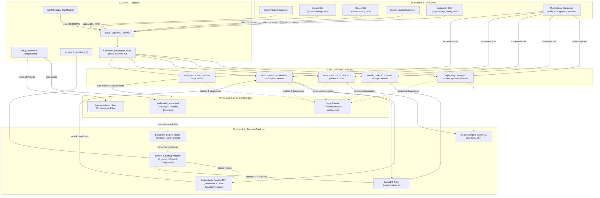

# code-intelligence

Read-only code intelligence for coding agents, served over the Model Context
Protocol. Code-intelligence indexes a workspace locally once, then gives Codex, Claude
Code, Cursor, agy, and other MCP hosts five tools: repository outline, structural
AST search, full-text search, hybrid semantic search, and bounded source reads.

No planner, no reviewer loop, no web research, no LSP process, no code edits.

## Architecture & Process Flow



## Install

```bash
cargo install code-intelligence --locked
# or from git repository:
cargo install --git https://github.com/ernestas-poskus/code-intelligence --locked
# or from a local checkout:
cargo install --path . --locked
```

Requirements:

- Rust 1.95+.
- The Protocol Buffers compiler (`protoc`) at build time. The `lance` crates
  generate their protobuf bindings during the build; install it with
  `brew install protobuf` on macOS or `apt-get install protobuf-compiler` on
  Debian/Ubuntu.
- A GPU for retrieval: Metal on macOS (Apple silicon), NVIDIA CUDA on Linux and
  Windows (builds on Linux/Windows need the CUDA toolkit; macOS needs no CUDA
  toolkit). The semantic search tool degrades to unavailable when the GPU or
  the models are missing; `search_code`, `search_ast`, `repo_map`, and
  `read_source` still work.
- The embedded models below (downloaded once into the model cache, ~2.5 GB).

## Library

`code-intelligence` is also a library. The facade exposes the same read-only operations
as the MCP server without spawning a process:

```rust,no_run
use code_intelligence::{Error, LanguageId, Limit, Operator, QueryText};

#[tokio::main]
async fn main() -> Result<(), Error> {
    let op = Operator::open(".").await?;
    let rust = LanguageId::try_from("rust")?;
    let map = op.repo_map(None, Some(&rust), Limit::new(50))?;
    let hits = op
        .search_code(
            &QueryText::from("read_source"),
            "literal",
            None,
            None,
            Limit::new(10),
        )
        .await?;
    println!("{} files, {} hits", map.len(), hits.len());
    Ok(())
}
```

`Operator::open` loads `.code-intelligence.toml` and builds the index when the local
models and GPU are available. Use `Operator::open_unindexed` for outline, AST,
literal/regex search and source reads without loading models; semantic search
then returns an `index_missing` tool error. `Operator::from_config` accepts a
programmatic `code_intelligence::Config`, and `Operator::serve_stdio` runs the MCP server
from the same in-process state.

The default feature set includes the TUI. Library-only consumers can drop the
terminal dependencies:

```toml
code-intelligence = { version = "0.1.0", default-features = false }
```

See [docs/library.md](docs/library.md) for the full API and error semantics.

## Set up a workspace

```bash
cd my-repo
code-intelligence init
```

`init` walks the workspace with ast-grep’s language detection, intersects the
result with the supported catalog, and asks which detected languages to index:

```text
Detected:
  Rust       1,284 files
  Go           312 files
  Dart          41 files
  Markdown      17 files

? Languages to index › [x] Rust (1284 files) [x] Go (312 files) ...
```

Use `--yes` for detected defaults, `--languages rust,go,dart` for an explicit
selection, or `--all-supported` to select the full catalog. The selection is
stored in `.code-intelligence.toml`; changing it changes the index identity.

```bash
code-intelligence reindex          # build/refresh the index
code-intelligence serve            # stdio MCP server
```

`init` also writes project-local host registrations (`.mcp.json`,
`.gemini/settings.json`, `.codex/config.toml`, `.cursor/mcp.json`,
`.agents/mcp_config.json`). Each file gets one `code-intelligence` entry, and
reconciling removes the retired `operator` entry. `serve --no-register` skips
that.

## Terminal UI

On a TTY, `code-intelligence init` opens a five-tab TUI: **Sources** (languages + include/
exclude tree), **Index** (progress, freshness, file events), **Stats**,
**Usage** (MCP tool calls and learn signals), and **Review**. `code-intelligence tui`
reopens the dashboard; `code-intelligence reindex --tui` starts it on the Index tab.

See [docs/tui.md](docs/tui.md) for keys and selection semantics. Non-TTY use
`code-intelligence init --yes` (or pass `--languages`, `--include`, `--exclude`).

## MCP tools

| Tool | Use |
|---|---|
| `repo_map` | ast-grep outline: files, symbols, imports, exports; generic file entries where no outline rule exists. |
| `search_code` | Indexed full-text (`fts`), literal substring, or regex search with path/language filters. |
| `search_ast` | ast-grep pattern or YAML rule search; read-only (fix/rewrite rules are rejected). |
| `search_semantic` | LanceDB dense + full-text fusion with optional rerank; requires `code-intelligence reindex`. |
| `read_source` | Exact line range of a workspace-contained file. |

All results are bounded and read-only. Code-intelligence does not expose type-aware
references, diagnostics, rename, or edits; use the host’s compiler/LSP for those.


## Design and stack

### Design choices

- **Read-only by construction.** The five tools return bounded snippets and
  never write, edit, rename, or run code. Type-aware navigation and diagnostics
  stay with the host's compiler/LSP.
- **Two retrieval paths, one workspace.** ast-grep handles outline and structural
  patterns without an index; LanceDB handles indexed lexical and semantic
  retrieval. Literal/regex search and `read_source` remain available when the
  model backend is absent.
- **Local-first.** The index lives under `.cache/retrieval`; models are loaded
  in-process through fastembed/candle. There is no model HTTP server, provider
  API key, or remote control plane. The first run downloads the model snapshots
  (about 2.5 GB) into the shared per-user cache — `~/.cache/fastembed`, or the
  configured Hugging Face cache — so every workspace on the machine reuses them
  offline.
- **Explicit corpus identity.** Languages, include/exclude paths, chunker,
  embedder, backend and index settings are baked into the table name. Changing a
  material input creates a new table and requires `code-intelligence reindex`; it never
  silently mixes old and new vectors.
- **Cheap-to-expensive ranking.** Dense and FTS candidates are fused, then the
  optional cross-encoder reranks only the fused pool. RRF is the default fusion;
  rerank pool 20 is the default cost/quality point.
- **MCP plus library.** The binary owns setup/TUI and stdio MCP; the library
  facade (`code_intelligence::Operator`) exposes the same read-only operations in-process.
  The TUI is an optional default feature, so library consumers can omit it.
- **Trust boundaries.** `read_source` and index discovery canonicalize paths and
  reject escapes; the learn journal stores hashed arguments and result shapes,
  not source text.

### Stack

| Layer | Choice |
|---|---|
| Language | Rust 1.95, edition 2024 |
| AST / outline | ast-grep 0.51 (`core`, `language`, `config`, `outline`), tree-sitter parsers |
| Vector index | LanceDB 0.41, Arrow 58 |
| Embedding + reranking | fastembed 7.7 with candle 0.11; Metal on macOS, CUDA on Linux/Windows; F16 by default |
| Full-text | LanceDB FTS with code-aware identifier tokenization |
| Chunking | xberg 1.3; document conversion is routed between anydoc 0.2 and xberg 1.3 per format ([details](docs/document-router.md)) |
| MCP | rmcp 3.7 over stdio |
| Async / CLI | Tokio 1, argh |
| TUI | ratatui 0.30, crossterm 0.29, notify 8 (optional `tui` feature) |
| Serialization | serde, serde_json, TOML |

## Evaluation

These are aggregate results from the retrieval evaluation work. The harness and
query fixtures are intentionally not distributed; no private query text or
judged source snippets are included here. Ranking and pool results use top-5
documents, path-deduped after reranking, on a frozen Rust corpus of 243 files /
4,404 chunks. Candidate-matrix and speed rows use the earlier 5-chunk metric
where noted; absolute values from the two methods are not directly comparable.
Statistics are paired sign tests plus bootstrap 95% confidence intervals against
the same-run baseline.

### Ranking and fusion

Baseline on the 109-query instrument: **nDCG@5 0.8018, recall@5 0.8899, MRR
0.7735**, with an oracle-reranker nDCG@5 of **0.9158**; the reranker is the
largest ranking lever, leaving about 0.11 nDCG@5 of headroom.

| Configuration | n | Δ nDCG@5 | 95% CI | W/L | p |
|---|---:|---:|---|---:|---:|
| RRF vs weighted, 109 queries | 109 | **+0.0217** | [−0.0081, +0.0559] | 9/4 | 0.267 |
| RRF + pool 20, 109 queries | 109 | **+0.0220** | [−0.0093, +0.0575] | 9/5 | 0.424 |
| RRF vs weighted, repaired set | 300 | **+0.0194** | [+0.0022, +0.0389] | 19/14 | 0.49 |
| RRF vs weighted, confirmation | 300 | **+0.0244** | [+0.0060, +0.0455] | 21/14 | 0.31 |
| RRF vs weighted, independent | 120 | **+0.0167** | [−0.0053, +0.0454] | 3/4 | 1.00 |

RRF is the shipped default because it is consistently positive across four
instruments, including a blind-authored independent set, and its gains come
from lexical rescues of identifier queries. Be explicit about the limit: the
strict pre-registered significance gate was not met (the largest runs still have
p ≈ 0.3–0.5 because most queries have no decided pair). The measured effect is
small but consistent; this is a product decision, not a claim of significance.

### Rerank pool and latency

| Configuration | n | nDCG@5 | Δ nDCG@5 | recall@5 | MRR | p50 / p95 ms |
|---|---:|---:|---:|---:|---:|---:|
| pool 30 | 300 | 0.7986 | — | 0.8867 | 0.7762 | 886 / 971 |
| **pool 20** | 300 | 0.7996 | **+0.0010** | 0.8817 | 0.7794 | **600 / 662** |
| pool 30, independent | 120 | 0.8747 | — | 0.9333 | 0.8801 | 1025 / 1411 |
| **pool 20, independent** | 120 | 0.8722 | −0.0025 | 0.9208 | 0.8843 | **811 / 999** |

Pool 20 is non-inferior on both instruments and **~32% faster at p95** on the
300-query set (~29% on the independent set). On the 109-query instrument,
RRF + pool 20 measured **602 ms p50 / 661 ms p95** versus 926/1389 ms for the
weighted pool-30 baseline, with nDCG@5 0.8239. Pool selection is query-time
only, so changing it does not reindex the workspace.

### Model choices

Embedder candidates on the 109-query instrument (incumbent
`mixedbread-ai/mxbai-embed-large-v1` at nDCG@5 0.7984):

| Candidate | nDCG@5 | Δ | Result |
|---|---:|---:|---|
| mxbai-embed-large-v1 (incumbent) | 0.7984 | — | shipped |
| F2LLM-v2-0.6B | 0.8082 | +0.0098 | no decision |
| papr-embed-code-0.6B | 0.8117 | +0.0133 | no decision |
| Qwen3-Embedding-0.6B | 0.8025 | +0.0041 | no decision |
| C2LLM-0.5B | 0.8220 | +0.0236 | point estimate only; p=0.65 and slower |

No embedder candidate cleared the adoption rule (effect floor, significance and
latency), so the incumbent stays. Reranker candidates likewise did not beat
`Qwen/Qwen3-Reranker-0.6B` (0.7984): coreb-code-reranker 0.7696, zerank-2 0.7397
(significantly worse), mxbai-rerank-large 0.7680, mxbai-rerank-base 0.7632.
The shipped code-search instruction matters: removing it costs **−0.0327**
nDCG@5, while the Rust-flavoured variant is flat.

Other measured choices:
- Reranking off: **−0.1112 nDCG@5** (p ≈ 0) — keep the reranker.
- Reranker window 8192 vs 512: **−0.0003** — keep 512.
- F32 vs F16: rank-identical — keep F16.
- Dense fusion weights 1.5/2.5 vs 2.0: no material delta — keep 2.0.

### Speed: in-process fastembed vs the old omlx HTTP backend

Same 109-query, 5-chunk measurement for both rows (the historical metric that
matches the archived omlx baseline; subsequent ranking results use the
path-deduped method described above):

| Backend | recall@5 | MRR | nDCG@5 | p50 ms | p95 ms |
|---|---:|---:|---:|---:|---:|
| omlx HTTP + MLX | 0.8486 | 0.7855 | 0.7984 | 1295 | 1609 |
| **fastembed/candle, in-process** | 0.8395 | 0.7691 | 0.7861 | **887** | **963** |
| Δ | −0.0092 | −0.0164 | −0.0123 | **−31%** | **−40%** |

The quality difference was not statistically detectable in the paired analysis
(all confidence intervals included zero), but it is a real point-estimate gap;
the likely source is MLX-quantised weights versus fastembed F16. A later
measurement-method correction re-baselined the same fastembed configuration at
nDCG@5 0.8018 with path-deduped top-5 documents, so the 0.7861 row is not
directly comparable to the 109-query baseline above. The operational win is
clear: no model server process, no HTTP round trip, no provider token, and
**31–40% lower query latency** while remaining in the same quality band.

### Evaluation limits

- All quality numbers are from one frozen Rust corpus. Other languages, larger
  repositories and different query mixes can change the ranking.
- CUDA builds are compile- and unit-tested without a GPU; Metal runtime results
  are the measured ones. CUDA runtime parity must be re-run before a backend
  release.
- The model and fusion matrices are decision evidence, not a public benchmark;
  the fixtures and per-query records are not shipped.
- RRF's effect is small relative to the current instrument's decision power.
  Treat the default as a shipped product choice with a transparent caveat, not
  as a statistically significant win.


## Languages

All ast-grep bundled languages:

Bash, C, C++, C#, CSS, Dart, Elixir, Go, Haskell, HCL, HTML, Java, JavaScript,
JSON, Kotlin, Lua, Markdown, Nix, PHP, Python, Ruby, Rust, Scala, Solidity,
Swift, TSX, TypeScript, YAML, Zig.

“Support” means ast-grep detection, parsing and structural search; languages
with a bundled outline rule also get symbols. Languages without one get a
generic file entry. Indexing is language-agnostic, so every selected language
participates in full-text and semantic search.

## Learn from tool usage

`serve` journals its own MCP calls locally (`~/.local/state/code-intelligence`) with
hashed arguments and result shapes. It does not see host-native tools or other
MCP servers, and it never edits agent instructions.

```bash
code-intelligence learn --json        # repeated calls, repeated errors, mismatches
```

The report suggests wording or description changes; applying them is manual.

## Configuration

`.code-intelligence.toml` is written by `init` and holds only the selected languages and
retrieval settings:

```toml
schema_version = 3
languages = ["rust", "go", "dart"]
# retrieval_include = ["docs"]
# retrieval_exclude = ["tests/fixtures"]
# retrieval_embed_model = "mixedbread-ai/mxbai-embed-large-v1"
# retrieval_rerank_model = "Qwen/Qwen3-Reranker-0.6B"
# retrieval_model_cache_dir = "~/.cache/fastembed"      # default; any HF cache is discovered first
# retrieval_model_dtype = "f16"                          # or "f32"
# retrieval_embed_backend = "bert"                       # or "qwen3"
# retrieval_embed_dim = 1024                             # model width (e.g. 2560 for Qwen3-4B)
# retrieval_rerank_blend = 0.0                           # 1.0 = pure reranker order
# retrieval_rerank_context = false                       # Module: hint on reranker docs
# retrieval_query_expansion = false                      # identifier tokens in the dense query
# retrieval_fusion_gate = false                          # RRF only when lexical adds candidates
# retrieval_query_log = "/path/search-queries.jsonl"      # opt-in, query text + paths only
# retrieval_dual_embed_model = "Qwen/Qwen3-Embedding-0.6B" # opt-in secondary index
# retrieval_dual_embed_dim = 1024
# retrieval_dual_embed_backend = "qwen3"
# retrieval_dual_route = true
```

Retrieval runs in-process through fastembed's candle backend: Metal on macOS,
CUDA on Linux/Windows. An existing Hugging Face / fastembed cache is discovered
before anything downloads; see
[`docs/retrieval-backend.md`](docs/retrieval-backend.md).

The index lives under `.cache/retrieval` and is keyed by the selected language
set, chunker, embedder and backend, and include roots. Changing any of them
requires `code-intelligence reindex`. Changing the embedder or backend changes the
index identity, so the first run after such a change reindexes.

## Development

```bash
cargo check
cargo nextest run --status-level fail -p code-intelligence
cargo clippy --all-targets
cargo fmt -p code-intelligence
```

See [`CONTRIBUTING.md`](CONTRIBUTING.md).
